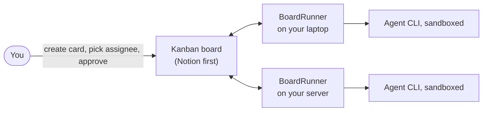

# BoardRunner

Run AI coding agents from a kanban board. Open a card, choose who does the work; the agent writes a plan on the card, waits for your approval, does the job and reports back on the same card.

> **Status: early. Not usable yet:** the card logic works against a fake board, and Notion and real agents are next ([plan](docs/PLAN.md)). The design comes from a private setup that runs daily.



## The idea

| You do | BoardRunner does |
| --- | --- |
| Create a card and pick an assignee | Picks it up and writes a plan on the card |
| Move the card to "Run" | Starts the agent in a sandbox |
| Add a revision note | Rewrites the plan |
| Nothing | Waits. Nothing starts without your approval |
| | Writes the result on the card when the job ends |

The board is the only hub: machines never talk to each other, each one handles only its own cards. If one is off, the others keep working.

## Development

```sh
uv run pytest
python3 boardrunner.py --version
```

## License

[MIT](LICENSE)
