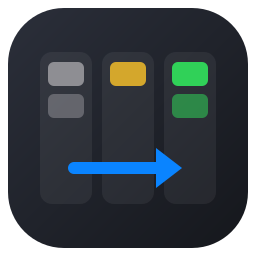
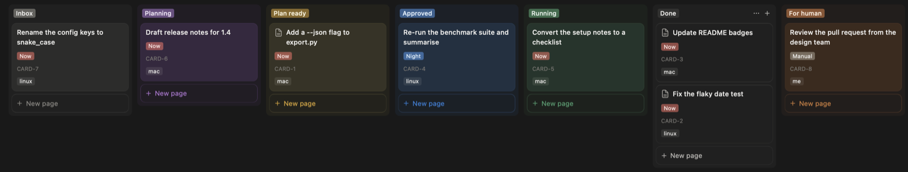
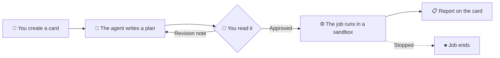
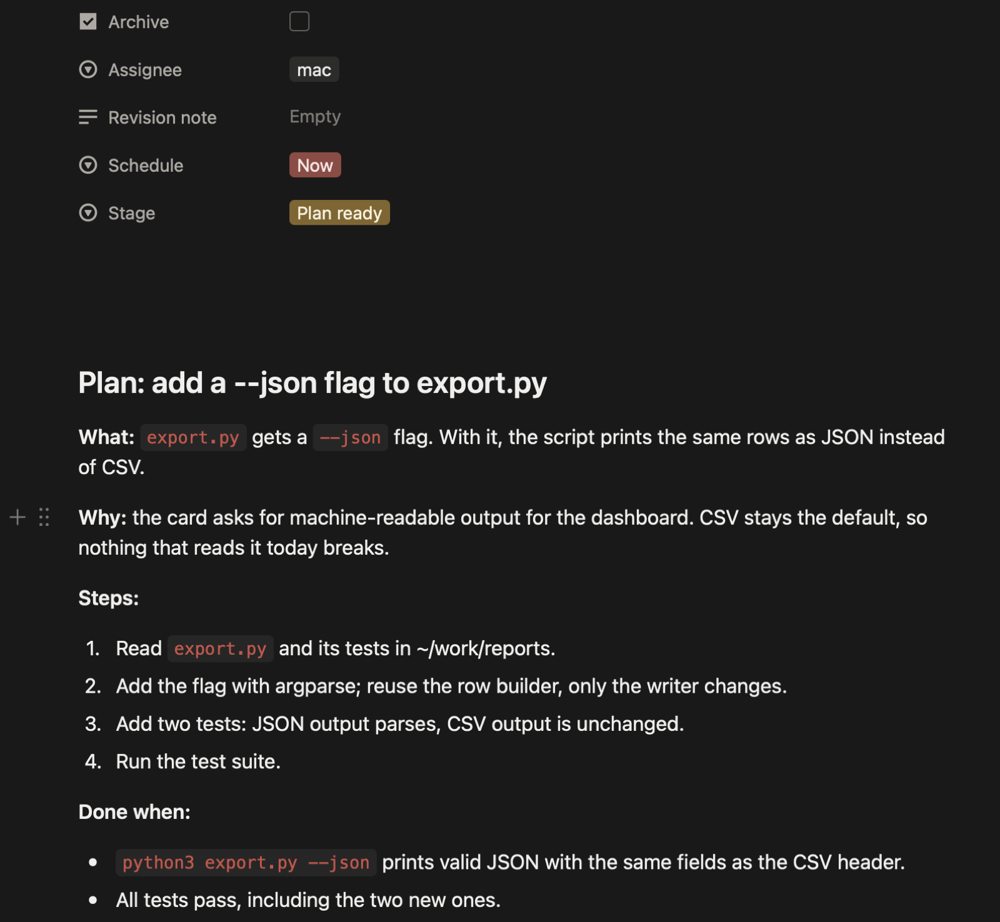
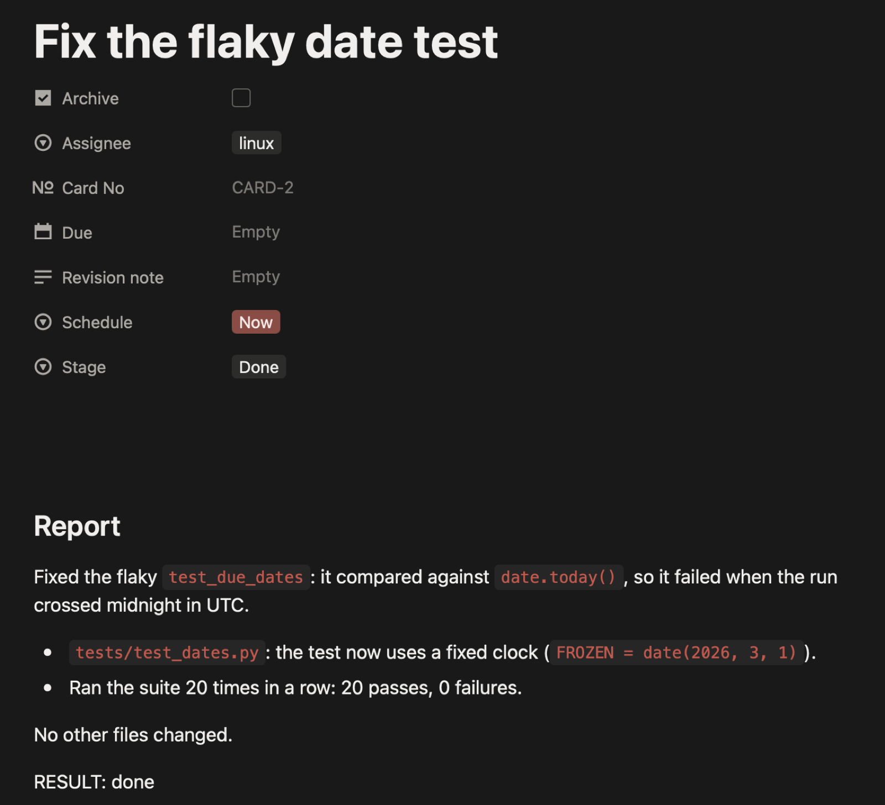
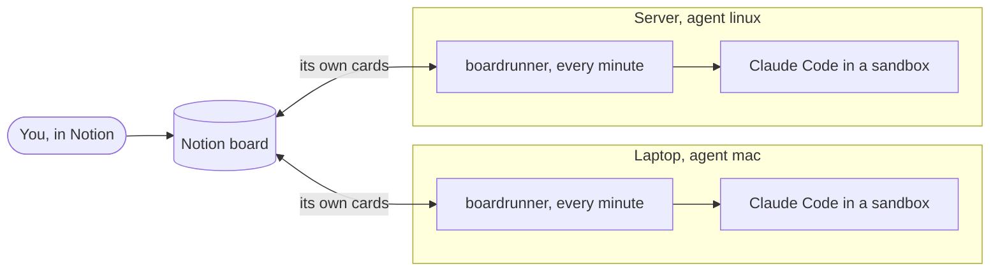

<p align="center">
  
</p>

<h1 align="center">BoardRunner</h1>

<p align="center">
  <b>Run AI coding agents from a Notion board. Nothing starts without your approval.</b>
</p>

<p align="center">
  
  
  
  
  
  
  
</p>

<p align="center"></p>

---

> [!NOTE]
> **This is a vibe-coded project.** BoardRunner was written by AI coding agents
> in Claude Code. I directed the work and tried it on real boards, but I have
> not read every line.
>
> **Models used:** Claude Opus 5.5 and Claude Sonnet 5.5.

Open a card, pick a machine. Claude Code writes a plan on the card and waits.
You read it, move the card to **Approved**, and the job runs in a sandbox on
that machine. The report lands on the same card. Your board is the only
interface: no server, no web app, no account besides Notion and Claude.

> **Status: early (v0.15).** Works on macOS and Linux, one or more machines per board. On Linux the sandbox needs `bubblewrap` and `socat` (`apt install bubblewrap socat`, or without sudo: `socat` from conda-forge on your PATH). Roadmap and open questions are in the [plan](docs/PLAN.md).

## How a card moves



<table>
  <tr>
    <td width="50%" align="center"></td>
    <td width="50%" align="center"></td>
  </tr>
  <tr>
    <td align="center"><sub><b>Plan ready.</b> What, why, steps, and how to tell it is done.<br/>Approve it, or write a Revision note and get a new plan.</sub></td>
    <td align="center"><sub><b>Done.</b> What changed and how it was checked.<br/>A job counts as done only if its report ends with <code>RESULT: done</code>.</sub></td>
  </tr>
</table>

## Features

- **Plan first, always.** Every card gets a written plan before anything runs.
  Only an edit made by you in Notion can approve it; an edit by the bot or by
  anyone else never starts a job.
- **Revise in place.** Type a change into the card's Revision note; the plan is
  rewritten and the note is cleared.
- **Schedules.** *Now*, *Night* (01:00 to 05:30 in your time zone), *At date*
  or *Manual*. Approve in the evening, read the report in the morning.
- **Several machines, one board.** A laptop and a server each run their own
  cards. Move a card to another machine and the job stops on the first one.
- **Sandboxed jobs.** No network, writes only in the work folder, no access
  to `~/.ssh` and similar folders.
- **Stop any time.** Move a running card to Stopped; the job ends within a
  minute and the card says when and why.
- **One file.** `boardrunner.py`, Python standard library only. Nothing to
  install, no server to keep up.

## Several machines, one board



The board is the only hub. Machines never talk to each other; each handles only
the cards assigned to it, so when one is off the others keep working.

## Stages

| Stage | Who moves it there | What happens |
|---|---|---|
| Inbox | you | A new card. Pick a machine (Assignee) and a Schedule |
| Planning | BoardRunner | The agent reads the card and writes a plan |
| Plan ready | BoardRunner | Read the plan: approve it, or write a Revision note for a new one |
| Approved | you | Waits for its Schedule: Now, Night, At date or Manual |
| Running | BoardRunner | The job runs in the sandbox |
| Done / Failed | BoardRunner | The report is on the card |
| Stopped | you | The job ends within a minute; the card says when |
| For human | BoardRunner | A card assigned to you (`me`); no agent touches it |

## You need

- Python 3.11 or newer. BoardRunner is one file, `boardrunner.py`, with nothing to install.
- [Claude Code](https://code.claude.com), signed in. Jobs use your Claude account.
- A Notion account.

## Five steps to a first card

1. In Notion, create an integration at <https://www.notion.so/my-integrations> (enable Read, Update and Insert content, and Read user information) and copy its secret. Create an empty page, add the integration under ••• > Connections, and copy the page link.
2. Make a folder such as ~/boardrunner (not under ~/Documents, ~/Desktop or ~/Downloads), put `boardrunner.py` in it and run every command from there. First: `export NOTION_TOKEN=<secret>`
3. `python3 boardrunner.py init --parent "<page link>" --live`
   It creates the board, the config, the work folder `~/work` and a private `.env`, then checks the setup.
4. `python3 boardrunner.py service`, then run the install line it prints. A pass now runs every minute.
5. On the board, create a card yourself: a title, Assignee = the agent `init` printed (`mac` or `linux`), Schedule = Now. After 3 to 5 minutes (a card you are still editing is left alone for 2) its Stage is Plan ready, with the plan in the card. Set Stage to Approved; the report arrives on the card when the job ends.

What `init` prints:

```text
Board created: https://app.notion.com/p/…
Config written: boardrunner.toml (mode: live, this machine's agent: mac)
Work folder created: /Users/you/work
Token saved to /Users/you/boardrunner/.env (only you can read it), so a service can use it. Keep it out of git.
Checking:
  ok   work folder /Users/you/work
  ok   Claude Code: /Users/you/.local/bin/claude
  ok   sandbox tools present
  ok   Notion token belongs to the configured integration
  ok   board fields present
  ok   every agent can be chosen on the board
  ok   human and integration are different users
Next: python3 boardrunner.py service, then create a card on the board.
```

## Safety

| | Inside a job | Why |
|---|---|---|
| Network | 🔴 off | A job cannot send your code anywhere or fetch anything |
| Writes | 🟡 only `~/work` | The rest of your disk stays as it was |
| Secrets | 🔴 `~/.ssh` and similar folders are unreadable | Keys stay on the machine |
| Start | 🟢 only after your own approval in Notion | The bot's edits and other people's never count |
| Card text | 🟡 treated as a task, never as permission | A card cannot turn the sandbox off |

Claude Code still sends the card text and the files it reads to Anthropic and
uses your quota. Limits: `max_jobs` per machine and `max_minutes` per job (360
by default).

## Good to know

- Notion lists the board's columns alphabetically and its API cannot reorder
  them; drag them once into the order you like.
- If a card does not move, run `python3 boardrunner.py doctor`, then
  `python3 boardrunner.py run --once` by hand. The service logs to
  `boardrunner.log`, one line with a time per event; when idle, one line an hour.
- On macOS, launchd cannot read ~/Documents, ~/Desktop or ~/Downloads, so keep
  the folder elsewhere.

## Documentation

[Guide](docs/guide.md) (stages, schedules, revisions, stopping, several machines, safety, development) ·
[Plan](docs/PLAN.md) ·
[Trying it for someone](docs/stranger-test.md)

## License

MIT; see [LICENSE](LICENSE).
