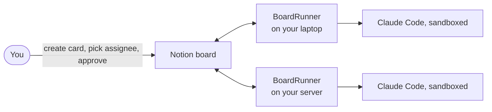

# BoardRunner

Run AI coding agents from a kanban board. Open a card, choose who does the work; the agent writes a plan on the card, waits for your approval, does the job and reports back on the same card. Today the board is Notion and the agent is Claude Code.

> **Status: early (v0.9).** Works end to end on macOS and Linux with Notion and Claude Code, including two machines sharing one board. Not yet tried: the Linux sandbox and installed service files ([plan](docs/PLAN.md)).



## The idea

| You do | BoardRunner does |
| --- | --- |
| Create a card, pick an Assignee and a Schedule | Picks it up and writes a plan on the card |
| Read the plan, move the card from **Plan ready** to **Approved** | Starts the agent in a sandbox when the Schedule allows |
| Type a change into the card's **Revision note** | Rewrites the plan and clears the note |
| Nothing | Waits. Nothing starts without your approval |
| | Writes the report on the card and moves it to **Done** or **Failed** |

The board is the only hub: machines never talk to each other, each one handles only its own cards. If one is off, the others keep working.

**Stages:** Inbox (you create the card) → Planning (the agent writes a plan) → Plan ready (you read it) → Approved (you approve) → Running → Done or Failed. A card assigned to you (`me`) goes to For human. Move a running card to Stopped to stop the job.

**Schedule:** an approved card starts only when its Schedule allows it. Now: on the next pass. Night: between 01:00 and 05:30 in the config's `timezone`. At date: once the Due date is reached. Manual, or empty: never by itself. For your first card, use Now.

## Requirements

- Python 3.11 or newer. Nothing to install: BoardRunner is one file, `boardrunner.py`.
- [Claude Code](https://code.claude.com) (`claude` on your PATH), signed in as the user that runs BoardRunner. Jobs use your Claude account and quota.
- A Notion account.
- macOS, or Linux with `bwrap` and `socat` for the sandbox (`apt install bubblewrap socat`). Without them, jobs with `sandbox = "strict"` refuse to start. `doctor` tells you what is missing.

## Set up

1. **Notion integration.** At <https://www.notion.so/my-integrations>, create an internal integration. Under Capabilities, enable Read, Update and Insert content, and Read user information. Copy its secret: this is your `NOTION_TOKEN`.
2. **A page for the board.** Create an empty page in Notion, open its ••• menu > Connections and add the integration. Copy the page link (••• > Copy link).
3. **Create the board.** In a folder of your choice, next to `boardrunner.py`:

   ```sh
   export NOTION_TOKEN=secret_...
   python3 boardrunner.py init --parent "<page link>" --agent laptop
   ```

   `init` creates the board inside that page and writes `boardrunner.toml` in the current folder, in `dry-run` mode. Each `--agent` becomes a choice in the board's Assignee field, and the first one is this machine (`me` in the config). The Assignee `me` means you do the card yourself. If your workspace has several people, `init` lists them: run it again with `--human-user <your id>`.

4. **Check.** Create the agent's work folder, the only folder a job may write to (`workdir` in the config, `~/work` by default), and run `doctor` until every line says ok:

   ```sh
   mkdir -p ~/work
   python3 boardrunner.py doctor
   ```

5. **Go live.** Set `mode = "live"` in `boardrunner.toml`.

Run every command from that folder, or put `--config <path>` before the command: `python3 boardrunner.py --config ~/br/boardrunner.toml doctor`. `dry-run` prints what each card would do and changes nothing; it never writes a plan.

## Your first card

1. In the Notion board, create a card yourself: title "Write hello.txt containing today's date", Assignee `laptop`, Schedule `Now`.
2. Wait two minutes. A card edited in the last two minutes counts as still being typed.
3. Run `python3 boardrunner.py run --once`. The card moves to Planning. Run it again a minute later: the plan is in the card body and the stage is Plan ready.
4. Read the plan. Set the stage to Approved.
5. Run `run --once` again: the card goes to Running, and a later pass moves it to Done or Failed with the report in the card body.

Each `run --once` is one pass over the board. To repeat it every minute, install a service (below).

Only cards created by you (`human_id` in the config) are handled. A card with a problem gets one note in its body. "Card was not created by the board owner": someone else or an automation created it. "Assignee is not an agent": pick one of your agents. "Last edit is not a verified human edit": make the change yourself in Notion. A job counts as done only when its report ends with `RESULT: done`; otherwise the card goes to Failed.

## Run it every minute

```sh
python3 boardrunner.py service
```

This writes launchd (macOS) or systemd (Linux) files into `./service` (change with `--output`) and prints the install line. It installs nothing. The files hold absolute paths to this Python, `boardrunner.py` and the config, so keep them where they are. Output goes to `boardrunner.log` beside the config.

A service does not see your shell, so put the token in a file named `.env` beside `boardrunner.toml`, as `NOTION_TOKEN=secret_...`, then `chmod 600 .env` and keep it out of git.

- **macOS:** keep the folder outside ~/Documents, ~/Desktop and ~/Downloads; launchd cannot read them. A service has a short PATH: if `doctor` finds `claude` only in your shell, set `claude_path = "/full/path/to/claude"` in your agent block. Remove with `launchctl unload ~/Library/LaunchAgents/com.boardrunner.plist`.
- **Linux:** `mkdir -p ~/.config/systemd/user` before installing, and `loginctl enable-linger $USER` so the timer keeps running after you log out. Remove with `systemctl --user disable --now boardrunner.timer`.

The service follows `mode`: in `dry-run` it only logs.

## Safety

- Planning is read-only: the agent may only read, list and search files.
- A job runs with no one watching, with shell commands and file edits, inside the Claude Code sandbox: its commands have no network, write only in the work folder, and cannot read ~/.ssh, ~/.aws, ~/.gnupg, ~/.netrc, ~/.config, the Keychain or any `.env`. Commands such as `git push`, `ssh`, `rsync`, `gh`, `rm` and `sudo` are denied.
- Claude Code still sends the card text and the files it reads to Anthropic and uses your quota. Limits: `max_jobs` per machine, `max_minutes` per job (360 by default).
- `sandbox = "off"` removes the sandbox: jobs can then reach the network and write anywhere you can.
- Only cards you created and approved yourself can start a job. Anyone who can edit the page can still change a card's text, so read the plan before you approve it.

## More than one machine

Copy `boardrunner.py`, the config and a `.env` to each machine, and sign in to Claude Code there. Add the machine's agent in the board's Assignee field (or run `init` with every `--agent` at the start: `--agent laptop --agent server`). Then on every machine but the first:

- set `me = "<that machine's agent>"`, and `primary = false` at the top level;
- fix that agent's `workdir`.

Using one integration everywhere is simplest. If a machine has its own integration, add the board to that integration's page access (Notion developer settings > the integration > Content access; adding the connection from the page menu may not be enough). Then set `bot_id` under `[board]` to the id that `doctor` prints, and list the other machines' integration ids in `peer_bot_ids`.

`boardrunner.example.toml` lists every config key, including optional ones (`timezone`, `primary`, `peer_bot_ids`, `model`, `max_minutes`, `instructions`, `claude_path`). Do not copy its placeholder ids.

## Development

The tests live in `tests/`. Run them with `uv run pytest` (or `python3 -m pytest`); BoardRunner itself needs no install.

```sh
uv run pytest
python3 boardrunner.py --version
```

## License

[MIT](LICENSE)
